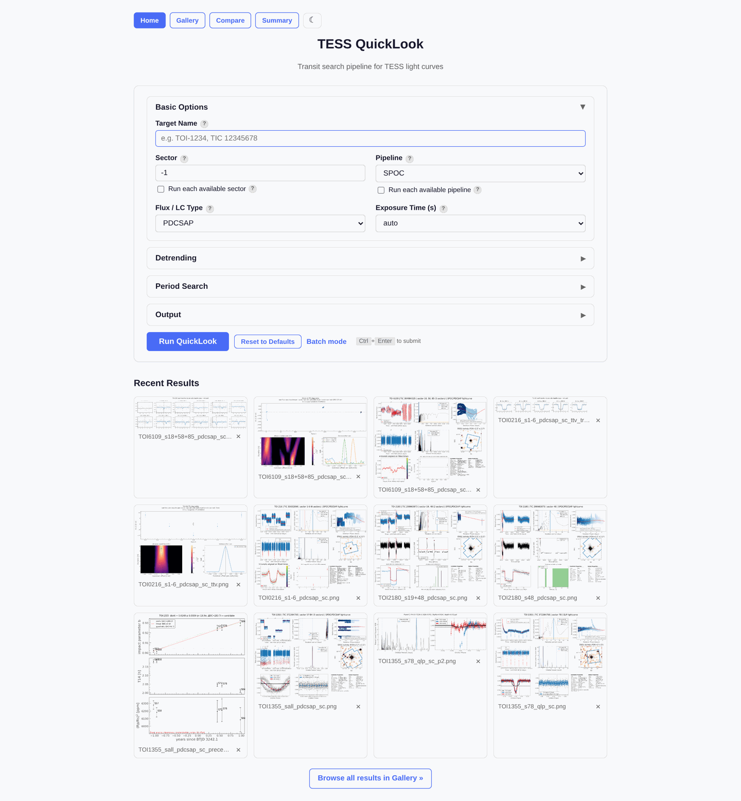
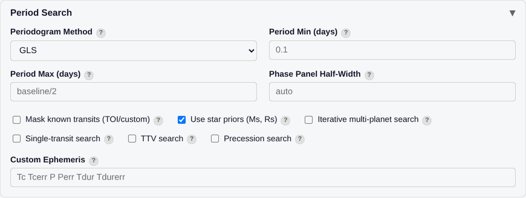
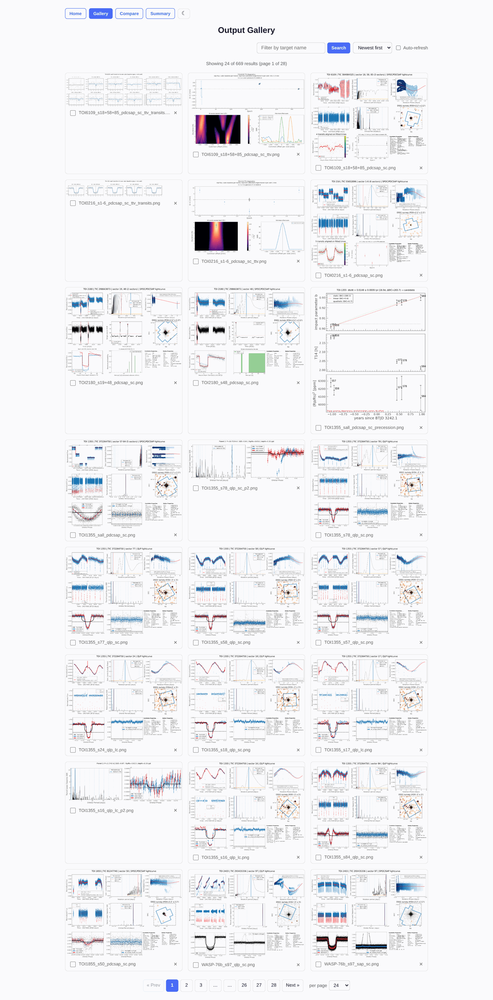

# Web GUI

QuickLook includes a Flask-based web interface for interactive analysis with live progress streaming.



## Starting the GUI

```bash
pip install -U "quicklook-package[gui]"
ql-gui
```

This starts a local server at [http://127.0.0.1:5000](http://127.0.0.1:5000).

!!! note
    The GUI runs pipeline jobs serially (one at a time) because lightkurve, astropy, and matplotlib share global state that is not thread-safe. Jobs submitted while another is running are queued and executed in order.

## Features

### Single target analysis

1. Enter a target name (TOI, TIC, or common name)
2. Adjust pipeline parameters (sector, pipeline, flux type, etc.)
   - **Sector** takes `-1` (latest), one sector number, `all` (stitch every sector of the pipeline into one light curve) or a list such as `57,58,77-84` (stitch just those). Stitching needs an **Exposure Time** so that only one cadence is stitched, as `--sector all` / `--sectors` do on the CLI. Click an available-sector chip to use it, Shift-click to add it to or remove it from a list, or click **all**.
3. Optionally toggle **Show SIMBAD** to overlay nearby non-stellar SIMBAD objects on the archival image (on by default in the GUI)
   - Under **Period Search**, tick **Single-transit search** to also look for individual transits; see [Single-transit search](single-transit.md). Stitch sectors (e.g. Sector `19,48`, Exposure Time `120`) to pair two transits into a duotransit. The TLS summary page then shows each target's `Class`, `N_ev`, `P_min` and `N_alias` (duotransit aliases)
   - Tick **TTV search** to fit every transit separately and test the O−C for transit-timing variations; see [TTV search](ttv-search.md). It needs >= 3 transits, so stitch sectors for long periods (e.g. Sector `1-6`, Exposure Time `120`). On active stars, give the planet's **Custom Ephemeris** (`Tc Tcerr P Perr Tdur Tdurerr`, spaces or commas; a malformed value is refused rather than ignored) to also get the `*_ttv.png` and `*_ttv_transits.png` diagnostics. The TLS summary page then shows `TTV [min]` and `p_TTV`
   - Tick **Precession search** (with Sector = `all` or a list, and an Exposure Time) to fit the transit shape per sector and test for a drift in the impact parameter; see [Precession search](precession-search.md). The mode selector next to it chooses **Planet**, **EB** (inner-binary inclination of an eclipsing binary; give the binary period and primary-eclipse T0 as a custom ephemeris) or **Auto** (EB when SIMBAD lists an eclipsing binary). The `*_precession.png` figure appears under the main result (as do `*_mono.png`, `*_ttv.png` and `*_ttv_transits.png` from the other searches), and the TLS summary page shows `db/dt [/yr]` (red for a precession candidate; hover for significance and flags). The form refuses Precession search on a single sector or with **Run each available sector/pipeline**, where it could only skip.

   
4. Click **Run QuickLook**
5. Watch live progress with step-by-step updates and ETA

### Each-sector mode

Check **Run each available sector** to automatically query all available sectors for the target and submit one job per sector. Jobs are queued and processed sequentially.

### Batch submission

Submit multiple targets at once. Each target runs with the same pipeline parameters. The job queue panel shows the status of all jobs.

### Job queue

The right-side panel shows all submitted jobs with their status:

- **Queued** -- waiting for the worker to pick it up
- **Running** -- currently executing
- **Done** -- completed successfully
- **Error** -- failed (hover for error details)
- **Cancelled** -- cancelled by user

Click a queued or running job to watch its live log output. Jobs auto-advance -- when one finishes, the WebSocket automatically connects to the next queued job.

### Results

Completed jobs display the output figure inline. Click to view full size. Results are saved in `quicklook/app/static/outputs/`.

### Gallery

The `/gallery` page shows all previously generated output figures with search, sorting, and pagination. Click a thumbnail to open it in a zoomable modal -- pan by dragging, and use the **left/right arrow keys** to step between figures without closing the viewer.



### Cancelling jobs

Click the **Cancel** button on a running or queued job to stop it. Queued jobs are skipped immediately when the worker reaches them.

### Deleting outputs

Right-click a result or use the delete button to remove output files (PNG and H5).

## Configuration

The GUI stores form state in the browser's localStorage, so your settings persist across page reloads. Click **Reset** to restore defaults.

## Dark mode

Click the theme toggle in the header to switch between light and dark mode. The preference is saved in localStorage.
