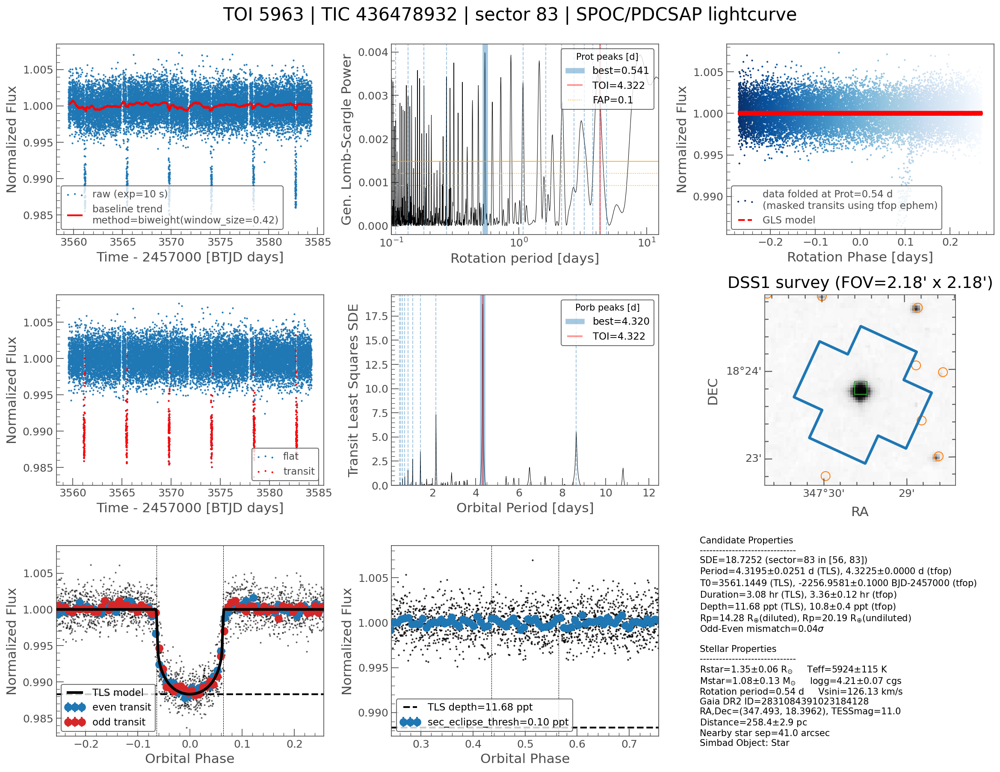

# QuickLook

**QuickLook** is a Python pipeline for detecting transit signals in [TESS](https://tess.mit.edu/) light curves. Given a target name, it downloads the light curve, runs periodograms to measure the stellar rotation period, searches for transiting companions using the [Transit Least Squares](https://ui.adsabs.harvard.edu/abs/2019A%26A...623A..39H/abstract) (TLS) algorithm, and produces a publication-ready diagnostic figure.

## What it does

- Downloads TESS light curves from [MAST](https://mast.stsci.edu/) via [lightkurve](https://docs.lightkurve.org/)
- Estimates the stellar rotation period using a Generalized Lomb-Scargle (GLS) periodogram
- Searches for periodic transit signals using TLS
- Overlays Gaia sources on archival sky images to check for blended neighbors
- Produces a 9-panel diagnostic figure summarizing all results
- Saves TLS results to HDF5 for downstream ranking and filtering

## Ways to use it

| Method | Best for |
|--------|----------|
| [CLI (`ql`)](cli.md) | Quick single-target analysis from the terminal |
| [Web GUI (`ql-gui`)](gui.md) | Interactive exploration with live progress |
| [Python API](api.md) | Notebooks, scripting, custom workflows |
| [Batch processing](batch.md) | Surveys and candidate vetting at scale |

## Output figure

Running `ql run --name WASP-21 --save` produces a 9-panel figure:

See [Pipeline Overview](pipeline.md) for a detailed explanation of each panel.

## Try it now

Each notebook installs `quicklook` when opened in Colab.

| Notebook | Topic | |
|---|---|---|
| [`examples.ipynb`](https://github.com/jpdeleon/quicklook/blob/main/notebook/examples.ipynb) | Quick-look basics: a planet, an eclipsing binary and more |  |
| [`single_transit_search.ipynb`](https://github.com/jpdeleon/quicklook/blob/main/notebook/single_transit_search.ipynb) | Mono- and duotransit search (TOI-2180 b) |  |
| [`ttv_search.ipynb`](https://github.com/jpdeleon/quicklook/blob/main/notebook/ttv_search.ipynb) | TTV search (TOI-216 c, TOI-6109 b) |  |
| [`precession_search.ipynb`](https://github.com/jpdeleon/quicklook/blob/main/notebook/precession_search.ipynb) | Precession search (TOI-1355 b, V907 Sco) |  |

## Links

- [GitHub repository](https://github.com/jpdeleon/quicklook)
- [PyPI package](https://pypi.org/project/quicklook-package/)
- Example notebooks: [basics](https://github.com/jpdeleon/quicklook/blob/main/notebook/examples.ipynb), [single-transit](https://github.com/jpdeleon/quicklook/blob/main/notebook/single_transit_search.ipynb), [TTV](https://github.com/jpdeleon/quicklook/blob/main/notebook/ttv_search.ipynb), [precession](https://github.com/jpdeleon/quicklook/blob/main/notebook/precession_search.ipynb)
