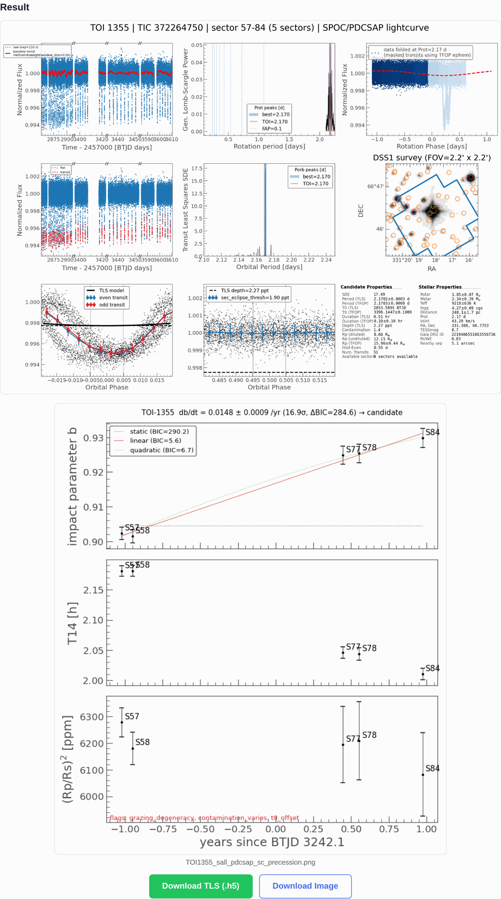
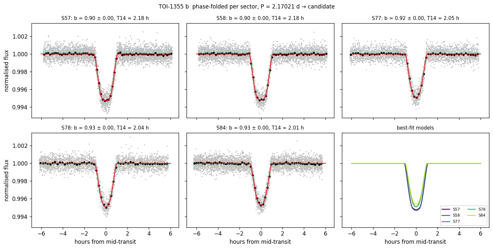
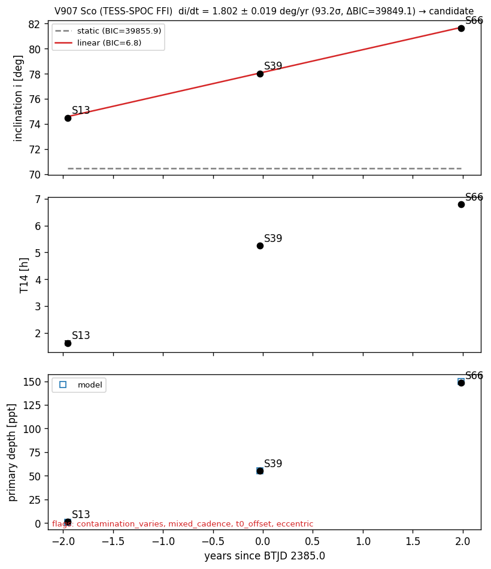

# Precession search

Nodal precession changes the sky-projected impact parameter `b` over years.
The transit gets shorter and shallower as `b` grows (and longer as it shrinks),
so two or more TESS sectors far enough apart can show a secular drift in
transit shape. `--precession-search` fits the transit shape in each sector and
tests whether `b` changes with time.

[](https://colab.research.google.com/github/jpdeleon/quicklook/blob/main/notebook/precession_search.ipynb) Example notebook: [`notebook/precession_search.ipynb`](https://github.com/jpdeleon/quicklook/blob/main/notebook/precession_search.ipynb) runs the TOI-1355 b and V907 Sco examples below.

Install the optional transit-fitting dependency before running the search.

```bash
pip install 'quicklook-package[precession]'
ql run --name TOI-1355 --sector all --exptime 120 --precession-search --save
```

In the GUI: Sector `all` (or a list such as `57,58,77-84`), Exposure Time
`120`, tick **Precession search** under Period Search, and Run. The
`*_precession.png` figure is shown under the quicklook figure. With Period
Min/Max 2.1/2.25 this reproduces the TOI-1355 b run below:



The search runs after the TLS (and optional TTV) search. It needs a
multi-sector light curve (`--sector all` or `--sectors ...`; quicklook already
requires a single `--exptime` there, so cadences are not mixed) and either a
periodic TLS signal (SDE >= 7, >= 3 transits) or a `--custom-ephem`.

`--precession-mode` picks the branch: `planet` (fit `b` per sector, below),
`eb` (fit the inner-binary inclination of an eclipsing binary; see
[Eclipsing binaries](#eclipsing-binaries)) or `auto` (the default: `eb` when
SIMBAD lists the target as an eclipsing binary, else `planet`). The GUI has
the same choice next to the **Precession search** checkbox.

## Method

1. **Sector windows.** Sector time ranges and the SPOC `CROWDSAP`/`FLFRCSAP`
   keywords are recorded when sectors are stitched. Data within 1.5 T14 of each
   transit are kept per sector; sectors with fewer than 5 in-transit cadences
   are dropped.
2. **Joint transit fit** (`batman`, circular orbit, quadratic limb darkening
   fixed at (0.35, 0.25)). `a/Rs` and limb darkening are shared across sectors
   because they do not change with time. `Rp/Rs`, `b`, a mid-time offset and a
   flux baseline are free in each sector, so a shape change is not forced into
   one parameter. Errors come from the Jacobian covariance, scaled up by the
   reduced χ² when that is above 1. `T14` and depth errors come from 2000
   draws of that covariance. Long-cadence data (> 10 min) are supersampled.
3. **a/Rs prior.** When ExoFOP lists R\* and M\*, Kepler's third law gives a
   Gaussian prior on `a/Rs`. At moderate `b` a free `a/Rs` lets every sector's
   `b` slide together and biases `db/dt`. At high `b`, where recent detections
   sit (TOI-1355 b, TOI-1518 b), the light curve constrains `b` on its own.
4. **Trend models.** Static, linear and (with >= 4 sectors) quadratic `b(t)`,
   generalized least squares using the joint fit’s full covariance between sector impact parameters, compared by BIC.

Geometry (circular orbit): `b = (a/Rs) cos i`, so
`di/dt = -(db/dt) / ((a/Rs) sin i)`. Only `|b|` is measurable, so a trend that
passes through `b = 0` looks like a V.

## Candidate test

A **precession candidate** needs all of:

- `|db/dt| >= 3σ`
- `BIC(static) - BIC(linear) >= 2`
- none of the blocking flags below

| Flag | Blocks | Meaning |
|------|:------:|---------|
| `short_baseline` | yes | sectors span < 1 yr; `db/dt` is reported but not trusted |
| `rp_absorbs_b` | yes | `grazing_degeneracy` and `depth_change` together: `Rp/Rs` may be absorbing the `b` change |
| `shape_sign_mismatch` | yes | `T14` trend has the same sign as `db/dt` (geometry requires the opposite) |
| `b_at_boundary` | yes | some sector's `b` is pinned at 0, where the covariance errors mean nothing |
| `grazing_degeneracy` | no | `|corr(b, Rp/Rs)| > 0.95` in some sector (expected near b ~ 1) |
| `contamination_varies` | no | `CROWDSAP` range across sectors > 0.01: dilution changes can mimic a depth change |
| `mixed_cadence` | no | sector cadences differ by > 10% |
| `t0_offset` | no | a sector's mid-time is > 3σ off the ephemeris (TTVs can distort shape); with 3+ sectors the offsets are taken from a linear refit of the per-sector mid-times, so a slightly wrong period or T0 (common for a TLS ephemeris over years) does not trip it |
| `depth_change` | no | `Rp/Rs` trend at >= 3σ (dilution, or transit-depth variations) |
| `nonlinear` | no | the quadratic model beats the linear one by ΔBIC >= 2 |

## Outputs

- Log line with `db/dt`, significance, ΔBIC, the verdict and flags.
- `*_precession.png`: `b`, `T14` and `(Rp/Rs)^2` per sector against time, with
  the static/linear/quadratic fits on the `b` panel.
- `*_precession_folds.png` (planet branch, candidates only): the phase-folded
  transit of each sector with its best-fit model and fitted `b` and `T14`, plus
  a panel overlaying every sector's model, to see the change in impact
  parameter directly.
- `*_tls.h5` keys (with `--save`): `precession_candidate`, `precession_db_dt`
  (+`_err`), `precession_significance`, `precession_delta_bic`,
  `precession_baseline_yr`, `precession_di_dt` (deg/yr),
  `precession_years_to_exit` (years from the last sector until
  `b = 1 + Rp/Rs`), `precession_flags`, `precession_reason`,
  `precession_a_rs`, `precession_a_rs_prior`, and per-sector arrays
  `precession_{sectors,t_mid,b,b_err,rp_rs,rp_rs_err,depth,depth_err,t14,t14_err,dt0,cadence,crowdsap,flfrcsap,corr_b_rp}`.

For TOI-1355 b, the sector panels show how each fitted model follows the
phase-folded transit data. Compare the overlaid models to see how the fitted
transit duration changes across sectors.



## Eclipsing binaries

In a hierarchical triple the third star makes the inner binary's orbit
precess, so its inclination `i` can drift by degrees per year and the eclipses
deepen or fade (V907 Sco, Zasche et al. 2023). `--precession-mode eb` fits `i`
in each sector.

```bash
ql run --name <EB> --sector all --exptime 120 --precession-search --precession-mode eb \
  --custom-ephem <T0> <T0err> <P> <Perr> <T14 [h]> <T14err> --save
```

Give the **binary** period with `T0` at the deeper (primary) eclipse. For
near-equal eclipses TLS usually finds `P/2`, which folds both eclipses
together, so pass `--custom-ephem` in that case.

**Model.** Two spherical, limb-darkened stars on a circular orbit. Each
eclipse is a `batman` occultation of one star by an opaque disc (exact for
any radius ratio, including an occulter larger than the star), diluted by the
other star's light (`L = J k²`) and an optional fixed third light. Ellipsoidal
variation and reflection are left out; the flattened light curve has mostly
removed them for detached systems. (`ellc` has no wheels and needs a Fortran
build; PHOEBE takes seconds per model, too slow for a joint least-squares fit.)

- **Shared:** `(R1+R2)/a`, `k = R2/R1`, the surface-brightness ratio `J`, and
  the secondary-eclipse offset from phase 0.5 (about `(2P/π) e cos ω`).
- **Per sector:** `i`, a mid-time offset and a baseline. The radii are shared,
  so any change in eclipse depth or duration has to come from `i`.
- Windows of 1.5 T14 around both eclipses are kept per sector. A sector
  without secondary-eclipse coverage still counts; `J` is then less constrained.

**Trend test.** The same static/linear/quadratic BIC comparison as the planet
branch, on `i(t)` with the joint covariance. Also reported:
`b = cos(i)/(R1/a)` and `db/dt = -(sin i/(R1/a)) di/dt`, so the GUI `db/dt`
column covers both branches (the hover gives `di/dt`).

**Model-free depth check.** In each sector the primary depth is measured from
the data alone: the out-of-eclipse median minus the mean within 0.1 T14 of
mid-eclipse. As `i` moves toward 90° the eclipse deepens, so this depth must
trend with the same sign as `di/dt`.

A **precession candidate** needs `|di/dt| >= 3σ`, `ΔBIC >= 2` and none of the
blocking flags:

| Flag | Blocks | Meaning |
|------|:------:|---------|
| `short_baseline` | yes | sectors span < 1 yr |
| `i_at_boundary` | yes | some sector's `i` is within 0.1° of 90°, where the covariance errors mean nothing |
| `depth_sign_mismatch` | yes | measured depth trend opposite to `di/dt` at >= 2σ |
| `dilution_mimics_depth` | yes | `contamination_varies` and the fractional `CROWDSAP` trend has the same sign and at least half the magnitude of the fractional depth trend over the same sectors |
| `contamination_varies` | no | `CROWDSAP` range across sectors > 0.01 |
| `mixed_cadence`, `t0_offset`, `nonlinear` | no | as in the planet branch |
| `no_secondary` | no | no sector covers a secondary eclipse: the secondary timing offset and its uncertainty are unavailable, and `J` is constrained only through dilution |
| `eccentric` | no | the secondary eclipse is > 3σ off phase 0.5 |

**Precession period.** The inner orbit normal precesses on a cone of
half-angle at most the mutual inclination `J` about the total angular
momentum, so `|di/dt| <= (2π/P_ν) sin J / sin i`. A measured `di/dt` alone
therefore gives an upper limit, `P_ν <= 2π / (sin i |di/dt|)`, reported as
`max_nodal_period_yr` when the trend is detected. With the outer orbit and
masses, `nodal_precession_period` gives `P_ν` from the quadrupole formula
(Söderhjelm 1975; Zasche et al. 2023 eqs. 2-3). For V907 Sco
(P1 = 3.7762 d, P2 = 142.01 d, e2 = 0.467, 2.56 + 2.74 M☉, m3 = 1.06 M☉,
J = 26.2°) it gives 63.7 yr against the published 63.5 (+3.3/-2.6) yr.

**Validation: V907 Sco (real data).** V907 Sco has only FFI light curves,
at a different cadence in each sector (S13: 30 min, S39: 10 min, S66: 200 s),
so `ql run --sector all` (one `--exptime`) cannot stitch them;
`scripts/validate_precession_v907sco.py` downloads the TESS-SPOC light curves,
flattens each sector with both eclipses masked and calls
`search_eb_precession` with the Zasche et al. ephemeris.

| Sector (year) | this branch: `i` | depth | Zasche et al. 2023: `i1` |
|---|---|---|---|
| 13 (2019) | 74.50 ± 0.05° | 1.6 ppt | 73.37 ± 0.25° ("very subtle dip") |
| 39 (2021) | 78.03 ± 0.04° | 55 ppt | 76.57 / 76.61 ± 0.02° |
| 66 (2023) | 81.64 ± 0.06° | 148 ppt | (after the paper; FRAM 2022: 78.55°) |

`di/dt = 1.80 ± 0.02 °/yr` (candidate), `P_ν <= 204 yr` (published 63.5 yr).
Between S13 and S39 the rate is 1.84 °/yr against 1.68 ± 0.13 °/yr from the
published inclinations. The absolute `i` is about 1.2° higher than published:
in partial eclipses `k` is poorly constrained (fitted 1.85; the paper's radii
give 1.06) and moves all sectors together, while the rate is stable (1.86
°/yr with the paper's 5.9% third light). The formal errors come from the
Jacobian and do not include this model systematic; treat them as lower limits.
The fitted secondary offset (−19.9 min, flagged `eccentric`) has the sign and
size that the published `e cos ω` predicts (−15 min).



**Outputs.** The log line gives `di/dt` and the period limit.
`*_precession.png` shows `i` (with the trend fits), T14 and the measured
primary depth (open squares: model depth). `*_tls.h5` has `precession_mode =
"eb"`, `precession_{di_dt,db_dt,ddepth_dt}` (+`_err`),
`precession_significance`, `precession_delta_bic`, `precession_baseline_yr`,
`precession_max_nodal_period_yr`, the binary
`precession_eb_{r_sum,k,sb_ratio,dt_sec}` (+`_err`) and
`precession_eb_third_light`, and per-sector arrays
`precession_{sectors,t_mid,inc,inc_err,b,b_err,depth,depth_err,depth_data,depth_data_err,t14,t14_err,dt0,cadence,crowdsap,flfrcsap,has_secondary}`.

```python
from quicklook.precession_eb import (
    search_eb_precession, nodal_precession_period, max_inclination_rate,
)

result = search_eb_precession(time, flux, flux_err, spans, period, t0, duration,
                              third_light=0.0)
result.di_dt, result.di_dt_err, result.is_candidate, result.max_nodal_period_yr
p_nu = nodal_precession_period(p_inner, p_outer, m1a, m1b, m_third, mutual_inc_deg, e_outer)
```

## Python API

```python
from quicklook.precession import SectorSpan, search_precession, a_rs_from_star

result = search_precession(
    time, flux, flux_err, spans, period, t0, duration,
    a_rs_prior=a_rs_from_star(period, r_star, m_star, r_err, m_err),
)
result.db_dt, result.db_dt_err, result.is_candidate, result.flags
```

## Validation

**TOI-1355 b (real data).** `ql run --name TOI-1355 --sector all --exptime 120
--period-limits 2.1 2.25 --precession-search` fits the five 2-min sectors
(57, 58, 77, 78, 84; 2.0 yr) and, in the original diagonal-error validation, gave `db/dt = 0.0149 ± 0.0012 /yr`
(12σ, ΔBIC = 146, candidate), within 1σ of the published
`0.01633 +0.00081/-0.00076 /yr` (Watanabe et al. 2026, who also used the
2019-2020 FFI sectors). `b` rises from 0.902 to 0.930, `T14` falls from 2.18 h
to 2.01 h, and `Rp/Rs` stays at 0.078-0.079. The `grazing_degeneracy` flag
(max `|corr(b, Rp/Rs)|` = 0.95) is informational here because `Rp/Rs` does not
trend.

With the current full-covariance method, `db/dt = 0.0148 ± 0.0009 /yr`
(16.9σ, ΔBIC = 284) — the same candidate, more significant — now that every
stitched sector normalizes to the same baseline. Previously,
`TessQuickLook.get_lc()` reselected each sector's raw, un-normalized flux
column *after* `LightCurveCollection.stitch()` had already normalized it, so
sectors downloaded at different absolute brightness levels (aperture,
background, pipeline drift) kept those offsets instead of settling on a
common baseline of 1 — visible as level jumps between TOI-1355's five sectors
in the raw light curve, which biased the per-sector transit-shape fit this
search depends on.


On synthetic four-sector light curves (three years, b ≈ 0.8) the tests check
recovery of an injected `db/dt` of ±0.03–0.04 /yr and a null false-positive
rate ≤ 5% over 20 noise realisations (`tests/test_precession.py`).

## Not yet implemented

- EB branch: eccentric-orbit eclipse shapes (only the secondary offset is
  fitted), ellipsoidal/reflection terms, a fitted third light, and a CLI option
  for the triple's outer orbit (use `nodal_precession_period` from Python).
- MCMC posteriors, LDTk limb-darkening priors, SAP vs PDCSAP comparison,
  half-sector splits.
- A regression run against TOI-1518 b, and an automated TOI-1355 b
  regression test (needs network).

## References

- Watanabe et al. (2026), TOI-1355 b, arXiv:2608.17387
- Zasche et al. (2023), V907 Sco, arXiv:2302.04613
- Watanabe, Narita & Hori (2024), TOI-1518 b, PASJ, doi:10.1093/pasj/psae019
- Söderhjelm (1975), A&A 42, 229 (quadrupole nodal precession)
- Szabó et al. (2012), KOI-13, doi:10.1111/j.1745-3933.2012.01219.x
- Winn (2010), transit duration, arXiv:1001.2010
