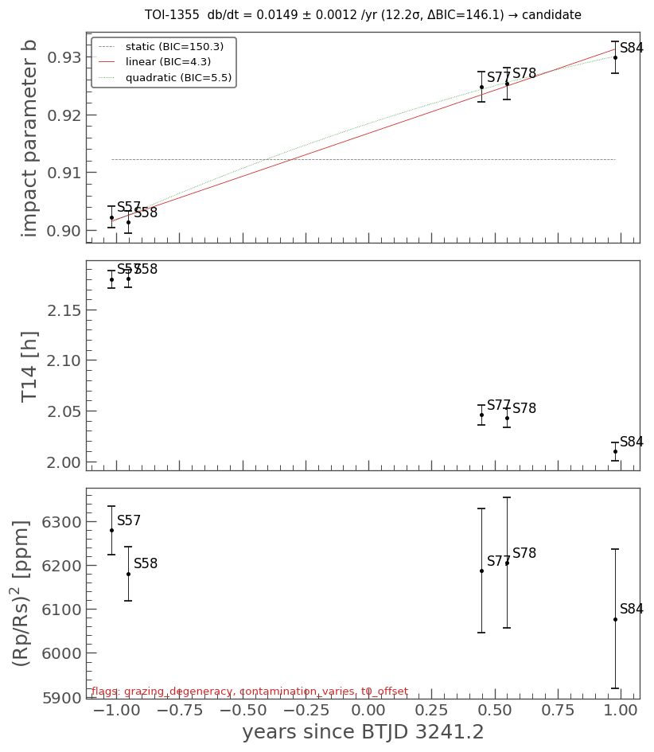

# Precession search

Nodal precession changes the sky-projected impact parameter `b` over years.
The transit gets shorter and shallower as `b` grows (and longer as it shrinks),
so two or more TESS sectors far enough apart can show a secular drift in
transit shape. `--precession-search` fits the transit shape in each sector and
tests whether `b` changes with time.

```bash
ql run --name TOI-1355 --sector all --exptime 120 --precession-search --save
```

The search runs after the TLS (and optional TTV) search. It needs a
multi-sector light curve (`--sector all` or `--sectors ...`; quicklook already
requires a single `--exptime` there, so cadences are not mixed) and either a
periodic TLS signal (SDE >= 7, >= 3 transits) or a `--custom-ephem`.

## Method

1. **Sector windows.** Sector time ranges and the SPOC `CROWDSAP`/`FLFRCSAP`
   keywords are recorded when sectors are stitched. Data within 1.5 T14 of each
   transit are kept per sector; sectors with fewer than 5 in-transit cadences
   are dropped.
2. **Joint transit fit** (`batman`, circular orbit, quadratic limb darkening
   fixed at (0.35, 0.25)). `a/Rs` and limb darkening are shared across sectors
   because they do not change with time. `Rp/Rs`, `b`, a mid-time offset and a
   flux baseline are free in each sector, so a shape change is not forced into
   one parameter. Errors come from the Jacobian covariance, scaled up by the
   reduced χ² when that is above 1. `T14` and depth errors come from 2000
   draws of that covariance. Long-cadence data (> 10 min) are supersampled.
3. **a/Rs prior.** When ExoFOP lists R\* and M\*, Kepler's third law gives a
   Gaussian prior on `a/Rs`. At moderate `b` a free `a/Rs` lets every sector's
   `b` slide together and biases `db/dt`. At high `b`, where recent detections
   sit (TOI-1355 b, TOI-1518 b), the light curve constrains `b` on its own.
4. **Trend models.** Static, linear and (with >= 4 sectors) quadratic `b(t)`,
   weighted least squares, compared by BIC.

Geometry (circular orbit): `b = (a/Rs) cos i`, so
`di/dt = -(db/dt) / ((a/Rs) sin i)`. Only `|b|` is measurable, so a trend that
passes through `b = 0` looks like a V.

## Candidate test

A **precession candidate** needs all of:

- `|db/dt| >= 3σ`
- `BIC(static) - BIC(linear) >= 2`
- none of the blocking flags below

| Flag | Blocks | Meaning |
|------|:------:|---------|
| `short_baseline` | yes | sectors span < 1 yr; `db/dt` is reported but not trusted |
| `rp_absorbs_b` | yes | `grazing_degeneracy` and `depth_change` together: `Rp/Rs` may be absorbing the `b` change |
| `shape_sign_mismatch` | yes | `T14` trend has the same sign as `db/dt` (geometry requires the opposite) |
| `b_at_boundary` | yes | some sector's `b` is pinned at 0, where the covariance errors mean nothing |
| `grazing_degeneracy` | no | `|corr(b, Rp/Rs)| > 0.95` in some sector (expected near b ~ 1) |
| `contamination_varies` | no | `CROWDSAP` range across sectors > 0.01: dilution changes can mimic a depth change |
| `mixed_cadence` | no | sector cadences differ by > 10% |
| `t0_offset` | no | a sector's mid-time is > 3σ off the ephemeris (TTVs can distort shape) |
| `depth_change` | no | `Rp/Rs` trend at >= 3σ (dilution, or transit-depth variations) |
| `nonlinear` | no | the quadratic model beats the linear one by ΔBIC >= 2 |

## Outputs

- Log line with `db/dt`, significance, ΔBIC, the verdict and flags.
- `*_precession.png`: `b`, `T14` and `(Rp/Rs)^2` per sector against time, with
  the static/linear/quadratic fits on the `b` panel.
- `*_tls.h5` keys (with `--save`): `precession_candidate`, `precession_db_dt`
  (+`_err`), `precession_significance`, `precession_delta_bic`,
  `precession_baseline_yr`, `precession_di_dt` (deg/yr),
  `precession_years_to_exit` (years from the last sector until
  `b = 1 + Rp/Rs`), `precession_flags`, `precession_reason`,
  `precession_a_rs`, `precession_a_rs_prior`, and per-sector arrays
  `precession_{sectors,t_mid,b,b_err,rp_rs,rp_rs_err,depth,depth_err,t14,t14_err,dt0,cadence,crowdsap,flfrcsap,corr_b_rp}`.

## Python API

```python
from quicklook.precession import SectorSpan, search_precession, a_rs_from_star

result = search_precession(
    time, flux, flux_err, spans, period, t0, duration,
    a_rs_prior=a_rs_from_star(period, r_star, m_star, r_err, m_err),
)
result.db_dt, result.db_dt_err, result.is_candidate, result.flags
```

## Validation

**TOI-1355 b (real data).** `ql run --name TOI-1355 --sector all --exptime 120
--period-limits 2.1 2.25 --precession-search` fits the five 2-min sectors
(57, 58, 77, 78, 84; 2.0 yr) and gives `db/dt = 0.0149 ± 0.0012 /yr`
(12σ, ΔBIC = 146, candidate), within 1σ of the published
`0.01633 +0.00081/-0.00076 /yr` (Watanabe et al. 2026, who also used the
2019-2020 FFI sectors). `b` rises from 0.902 to 0.930, `T14` falls from 2.18 h
to 2.01 h, and `Rp/Rs` stays at 0.078-0.079. The `grazing_degeneracy` flag
(max `|corr(b, Rp/Rs)|` = 0.95) is informational here because `Rp/Rs` does not
trend.



On synthetic four-sector light curves (three years, b ≈ 0.8) the tests check
recovery of an injected `db/dt` of ±0.03–0.04 /yr and a null false-positive
rate ≤ 5% over 20 noise realisations (`tests/test_precession.py`).

## Not yet implemented

- Eclipsing-binary branch (`ellc`/PHOEBE with per-sector `i1`, triple-star
  precession period).
- MCMC posteriors, LDTk limb-darkening priors, SAP vs PDCSAP comparison,
  half-sector splits.
- Regression runs against TOI-1518 b and V907 Sco, and an automated TOI-1355 b
  regression test (needs network).

## References

- Watanabe et al. (2026), TOI-1355 b, arXiv:2608.17387
- Zasche et al. (2023), V907 Sco, arXiv:2302.04613
- Watanabe, Narita & Hori (2024), TOI-1518 b, PASJ, doi:10.1093/pasj/psae019
- Szabó et al. (2012), KOI-13, doi:10.1111/j.1745-3933.2012.01219.x
- Winn (2010), transit duration, arXiv:1001.2010
