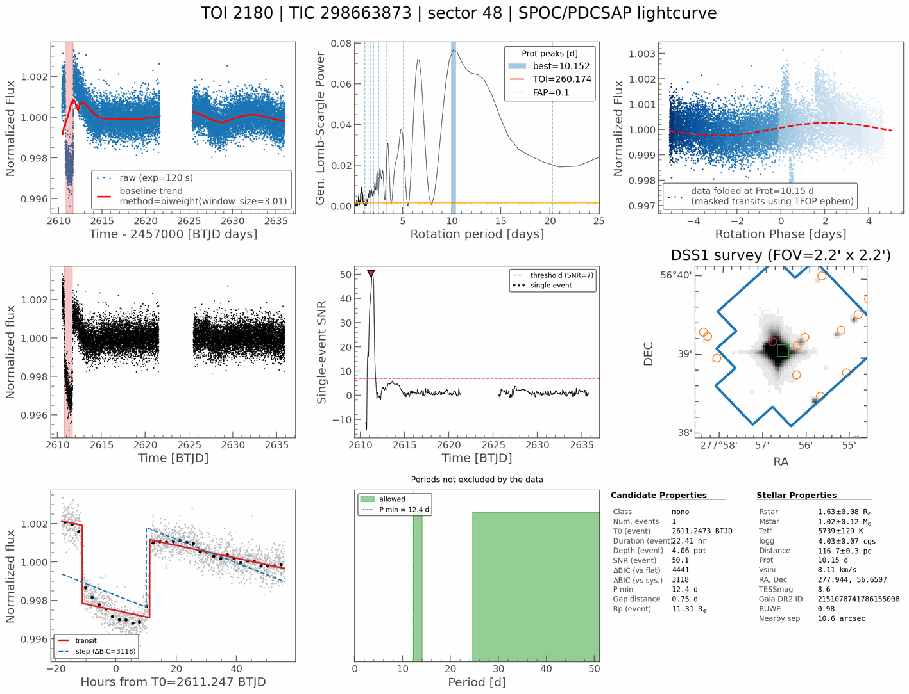
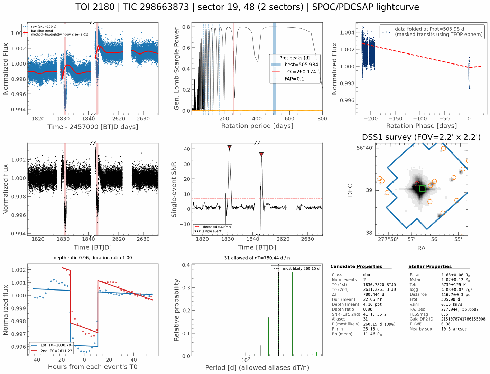

# Single-transit search

Transit Least Squares (TLS) needs about three transits, so a planet whose
transit appears only once or twice in the data is never found reliably by the
periodic search. With `--single-event-search` (CLI) or the **Single-transit
search** checkbox (GUI), QuickLook also looks for individual dips, pairs two
matching dips into a duotransit, and classifies each target.

This is tracked in [issue #42](https://github.com/jpdeleon/quicklook/issues/42).

## How it works

The search runs on the flattened light curve, after TLS
(`quicklook/single_event.py`):

1. **Box search over a stellar duration grid.** A box is slid across the light
   curve for 12 log-spaced durations. The range runs from grazing transits at
   half the longest gap-free stretch of data (not the total span, which can be
   years for stitched sectors) up to eccentric orbits at ~1000 d, using the
   ExoFOP stellar density (solar if unknown) and capped at 1.5 d, since longer
   dips do not survive typical detrending. Long-period transits can be much
   shorter or longer than the usual 1-12 h
   ([Talens, Aigrain et al. 2025](https://doi.org/10.3847/2515-5172/ae2305)).
2. **Red-noise-aware SNR.** Each trial's depth is divided by the larger of the
   white-noise expectation and the robust scatter of box depths across the
   whole light curve at that duration, so correlated noise does not create
   false events.
3. **Gap and edge exclusion.** A trial needs at least 0.1 d (or a quarter of
   the duration, if longer) of data on both sides, so dips at a data edge or gap
   edge are not reported, while a long transit just after the data start still
   is.
4. **Systematics test.** The strongest peaks with SNR ≥ 7 have their centre
   and duration refined, then are fitted locally with a transit model and with
   step and quadratic-ramp models (all on a linear baseline; the step position
   is scanned). An event is kept only if the transit beats the better systematics
   model by ΔBIC ≥ 10, in the spirit of
   [Foreman-Mackey et al. 2016](https://doi.org/10.3847/0004-6256/152/6/206).
5. **Period lower limit.** For the strongest event, `P min` is the smallest
   period whose other transits would all fall outside the covered data. Data
   gaps can hide a second transit, so this can be shorter than the distance to
   the far data edge.
6. **Duotransit pairing** (`quicklook/duo.py`). Two events whose depths agree
   within 3σ (each event's σ is depth/SNR plus a 5% systematic floor) and whose
   durations agree within a factor of 1.5 form a duotransit. Their separation
   ΔT allows periods ΔT/n. An alias is dropped if any of its other predicted
   transits lands in covered data
   ([Cooke et al. 2020](https://doi.org/10.1093/mnras/staa3569);
   [Hawthorn et al. 2024](https://doi.org/10.1093/mnras/stad3783)). The rest are
   weighted by P<sup>-5/3</sup> (transit probability × log-uniform period
   prior) and by how likely the observed duration is for a transit at that
   period around the host star
   ([Osborn et al. 2016](https://doi.org/10.1093/mnras/stw137)), with a tail for
   eccentric orbits.

## Classification

| `event_class` | Meaning |
|---------------|---------|
| `periodic` | TLS found a signal with SDE ≥ 7 and at least 3 transits |
| `duo` | No periodic signal; two consistent events with at least one allowed alias |
| `mono` | No periodic signal; at least one single event, but no consistent pair |
| `none` | None of the above |

Two transits are not enough for `periodic`: TLS can fit P = ΔT with exactly two
transits, but that is just one of the ΔT/n aliases, which the duo pairing lists
instead.

An event that coincides with a TLS transit is "explained". For a `periodic`
target, any unexplained event is still reported, and a second figure,
`*_mono.png`, shows the strongest one. Several events with no consistent pair
are reported as `mono`, and the strongest event is the one described.

Duotransits need both transits in the light curve, so stitch the sectors with
`--sectors` (e.g. `--sectors 19,48 --exptime 120`) or `--sector all`.
`--each-sector` runs each sector separately and can only find single events.

## Example

TOI-2180 b (P ≈ 261 d) transits once in TESS sector 48, 0.25 d after the data start:

```bash
ql run --name TOI-2180 --sector 48 --single-event-search --save
```



The search finds one 22 h, 4 ppt event (SNR 50) that beats a step model by
ΔBIC ≈ 3100. TLS reports SDE 14.6 but with a single transit, so the target is
`mono`. `P min` is 12.4 d rather than ~25 d because a second transit at that
period would fall in the mid-sector gap. Panel 1 also shows why longer
detrending windows matter for long transits: the 3 d biweight trend sags into
the dip and leaves shoulders on either side.

TOI-2180 b also transits in sector 19, 780.5 d (3 × P) earlier. Stitching the
two sectors gives a duotransit:

```bash
ql run --name TOI-2180 --sectors 19,48 --exptime 120 --single-event-search --save
```



The two events agree in depth (4.3 and 4.1 ppt) and duration (22 h each). Of
the 780.44/n aliases, 31 survive the coverage check (P ≥ 25.2 d). With the
host's density (0.24 ρ<sub>☉</sub>), the true period, 260.15 d (n = 3), is the
most likely at 39%, but 390.22 d (n = 2) is close at 37% and 195.11 d (n = 4)
gets 17%. Two sectors alone cannot settle the period. A third sector, or a
targeted observation at a predicted time, would.

## Figure layout

For a `periodic` (or `none`) target the 9-panel figure is unchanged. For a
`mono` or `duo` target these panels change:

| Panel | Default | Mono layout | Duo layout |
|-------|---------|-------------|------------|
| 1 | Raw light curve + trend | Same, with the event shaded | Same, both events shaded |
| 4 | Flattened light curve + TLS transits | Flattened light curve with the event shaded | Same, both events shaded |
| 5 | TLS periodogram | Single-event SNR vs time, threshold and detected events | Same |
| 7 | Odd/even transits | Zoom on the event with the transit model and the best systematics model (with ΔBIC) | Both events overlaid on their own T0, with depth and duration ratios |
| 8 | Secondary eclipse | Periods not excluded by the data, with `P min` | Allowed aliases ΔT/n and their relative probability |
| 9 | Summary | Class, event T0, duration, depth, SNR, ΔBIC, `P min`, gap distance and radius estimate | Class, both T0s, ΔT, mean duration and depth, depth ratio, SNRs, number of aliases, most likely P, `P min`, radius estimate |

When the light curve spans separate sectors (any gap longer than 10 d), the
time panels (1, 4 and 5) use a broken x-axis: one sub-panel per sector, a
shared flux axis and diagonal break marks, so years-long gaps do not squeeze
each sector into a sliver. Orbit gaps and consecutive sectors stay on one axis.
The helper (`quicklook/broken_axis.py`) is ported from
[allesfitter2](https://github.com/jpdeleon/allesfitter2/blob/main/allesfitter/plot_utils.py).

## Saved outputs

When the search is enabled, these fields are added to `*_tls.h5`:

| Field | Description |
|-------|-------------|
| `single_event_search` | `True` |
| `event_class` | `none` / `mono` / `duo` / `periodic` |
| `n_events` | Number of individually detected events |
| `n_unexplained_events` | Events not coinciding with a TLS transit |
| `single_event_t0`, `_duration`, `_depth`, `_snr` | Strongest unexplained event (days, fraction) |
| `single_event_delta_bic_null`, `_delta_bic_systematics` | BIC margin over a flat baseline and over the best step/ramp model |
| `single_event_dist_to_gap` | Distance to the nearest data gap or edge (days) |
| `p_min` | Period lower limit (days): the shortest allowed alias for a duo, otherwise from the strongest unexplained event; NaN without one |
| `event_t0s`, `event_durations`, `event_depths`, `event_snrs` | All detected events |
| `duo_t0s`, `duo_delta_t`, `duo_depth_ratio` | The duotransit pair (empty/NaN otherwise) |
| `n_aliases`, `p_aliases`, `p_alias_weights` | Allowed periods ΔT/n and their normalised weights |
| `p_best` | Most likely alias (days) |

The GUI's TLS summary page shows `Class`, `N_ev`, `P_min [d]` and `N_alias`
columns, which can be sorted and filtered (e.g. type `duo` under Class).

## Caveats

- A single transit gives only a lower limit on the period, never a TLS period.
- Alias weights are a ranking, not a posterior: they assume uniform impact
  parameter, a simple eccentricity tail and the catalogue stellar density.
  A full period posterior is step 4 of #42.
- Hard quality-flag masking already removes momentum-dump cadences, so they
  show up as gaps; check `single_event_dist_to_gap` for events close to one.
- Scattered light, flares on the way down and residual detrending artefacts can
  still pass the systematics test. Always look at the event zoom (panel 7).
