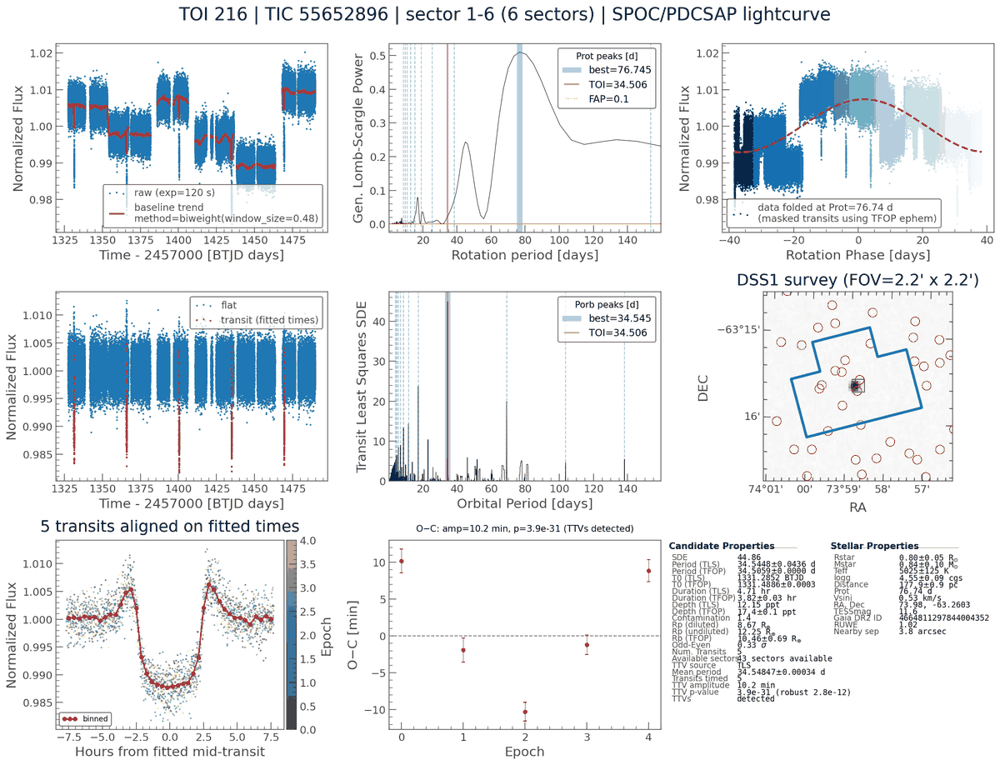

# TTV search

Transit Least Squares (TLS) folds the light curve on a strictly linear
ephemeris. When transit-timing variations (TTVs) are larger than about half a
transit duration, the folded transit is smeared and loses signal. The iterative
multi-planet search then masks transits at the linear ephemeris, leaves the
displaced ones in, and can find them again as a fake second signal near the
same period. With `--ttv-search` (CLI) or the **TTV search** checkbox (GUI),
QuickLook fits every transit on its own.

This is step 5 of [issue #42](https://github.com/jpdeleon/quicklook/issues/42).

## How it works

The search lives in `quicklook/ttv.py`, and `quicklook/ttv_pipeline.py`
connects it to the pipeline:

1. **Starting ephemeris.** By default this is the TLS period, T0 and duration.
   The TLS signal must count as periodic, as in the single-transit search
   (SDE ≥ 7 and at least 3 transits). Otherwise, if
   `--single-event-search` is also on, three or more single events are
   chained (see below).
2. **Per-transit fits.** Around each predicted time `T0 + n·P`, a trapezoid
   (ingress 15% of the duration) on a local linear baseline is fitted with a
   free mid-time within ±δ, a free depth and a free duration (0.5–2.5× the
   TLS value). δ is one duration, capped at a quarter of the period. A coarse
   grid over the mid-time is refined with `scipy.optimize.least_squares`. The
   timing error comes from the Jacobian, scaled up by the reduced χ² when the
   local scatter exceeds white noise. An epoch is skipped if it has less than
   half the expected cadences in transit or within one duration on either
   side, if its depth SNR is below 3, or if the fit is pinned at ±δ.
3. **O−C.** A weighted linear ephemeris goes through the fitted times. The O−C
   amplitude is half its peak-to-peak. The χ² of the linear model gives a
   p-value. TTVs are flagged when p < 10⁻³ **and** p stays below 10⁻³
   after dropping the transit with the largest |O−C|/σ. Per-transit timing
   errors have heavier tails than a Gaussian: on simulated light curves
   without TTVs, the plain χ² test alone flags 2–3% at p < 10⁻³, and the
   leave-worst-out check brings this to 0 of 120. At 2-min cadence with a
   2.6 min timing error, a 6 min sinusoidal TTV is detected 70% of the time
   and a 12 min one every time.
4. **Masking at fitted times.** The iterative re-search (`--iterative`)
   removes the primary's transits at their fitted times. Epochs without a fit
   keep the linear-ephemeris mask.
5. **Cycle-count ambiguity.** Between fitted transits more than 30 d apart
   (e.g. sectors a year apart), the orbit count can be off by one. Every
   ±1-cycle shift per gap (up to 4 gaps) whose linear fit is within Δχ² = 9 of
   the best is reported, with its period.
6. **Chaining single events.** With both searches on and no periodic TLS
   signal, three or more single events that agree in depth and duration (the
   duotransit test) are chained. The longest period that places each event
   within one duration of `t0 + n·P` gives the starting ephemeris. As with
   duotransits, an integer fraction of that period also fits. If at least
   three transits are then fitted, the target becomes `periodic` and
   `ttv_source` is `chain`.

QATS ([Carter & Agol 2013](https://doi.org/10.1088/0004-637x/765/2/132)) is
not implemented. It would be the next step for transits too shallow to fit one
by one.

## Example

TOI-216 has two planets near a 2:1 resonance with known TTVs. Stitching
sectors 1–6:

```bash
ql run --name TOI-216 --sectors 1,2,3,4,5,6 --exptime 120 --ttv-search --save
```

TLS finds TOI-216 c at P = 34.545 d (SDE 45). All 5 transits are fitted.
The O−C swings by ±10 min (amplitude 10.2 min, p = 4×10⁻³¹, still
3×10⁻¹² without the worst transit), so TTVs are flagged. With no epoch
missing between transits, the cycle count is unique.



The small bumps on either side of the aligned transits (panel 7) come from
the pipeline's 0.48 d biweight window, which is only ~2.4× the 4.7 h duration.
They are symmetric, so they do not shift the fitted times. A longer
`--window-length` removes them.

## Figure layout

When at least 3 transits are fitted (and the target is not `mono`/`duo`):

| Panel | Default | TTV layout |
|-------|---------|------------|
| 4 | Flattened light curve + TLS transits | Transits highlighted at their fitted times |
| 7 | Odd/even transits | Every transit aligned on its own fitted mid-time, coloured by epoch, with the binned median |
| 8 | Secondary eclipse | O−C (minutes) with errors, amplitude and p-value; red when TTVs are detected; notes other cycle counts that also fit |
| 9 | Summary | Adds TTV source, mean period, transits timed, TTV amplitude, p-values and the number of cycle solutions |

The odd/even and secondary-eclipse checks are not shown in this layout. Run
without `--ttv-search` to see them.

## Saved outputs

These fields are added to `*_tls.h5`:

| Field | Description |
|-------|-------------|
| `ttv_search` | `True` |
| `ttv_source` | `tls`, `chain`, or empty if nothing was timed |
| `ttv_detected` | TTVs significant by both p-values |
| `ttv_amplitude`, `ttv_rms` | Half the O−C peak-to-peak and the O−C RMS (days) |
| `ttv_pvalue`, `ttv_pvalue_robust` | χ² p-value of a linear ephemeris, and the same without the worst transit |
| `n_ttv_transits` | Number of fitted transits |
| `ttv_period`, `ttv_t0` | Weighted linear ephemeris through the fitted times |
| `ttv_delta` | Half-width of the mid-time search window (days) |
| `ttv_epochs`, `ttv_tcs`, `ttv_tc_errs`, `ttv_durations`, `ttv_depths`, `ttv_snrs`, `ttv_oc` | Per-transit fits |
| `ttv_n_cycle_solutions`, `ttv_alt_periods` | Number of cycle-count solutions and the periods of the alternatives |

The GUI's TLS summary page shows `TTV [min]` (red when detected) and `p_TTV`
columns, which can be sorted and filtered.

## Caveats

- The p-value is only as good as the timing errors. Spot crossings, flares and
  detrending residuals inside one transit can shift its fitted time. Check the
  aligned-transit panel before trusting a detection.
- TTVs larger than δ (one duration) are pinned to the window edge and skipped.
  For such systems the transits are usually also missed by TLS. Chaining
  single events (with `--single-event-search`) uses a one-duration tolerance
  too.
- Depth and duration are fitted per transit and stored, but not yet tested for
  variation.
